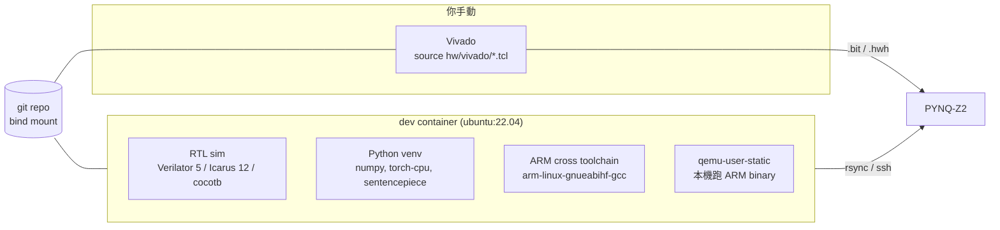

# 計劃書評估 & 開工前討論

## 0. 目前環境現況

| 項目 | 狀態 |
|---|---|
| Host | WSL2 (x86_64, 12 cores, 14 GB RAM, 949 GB free) |
| Docker | 29.4.3 + Compose v5.1.4，尚無 image / container |
| Workspace | `/home/a/Heterogeneous-CPU-NPU-Compute-GPU-System` 空目錄，尚未 `git init` |
| GitHub repo | SSH 可連線，remote 為空 repo |
| Vivado | WSL 與 `/mnt/c` 下皆未找到 → 推測在其他機器 / Windows 其他路徑 |
| Host 工具 | 只有 iverilog 11、Python 3.10（之後全部改由 Docker 提供） |

---

## 1. Docker 環境提案

**原則：** Docker 負責「除了 Vivado 以外的一切」；Vivado 由你手動操作，repo 只提供可重建的 TCL / IP 原始碼。



- **Base image `ubuntu:22.04`**：PYNQ v3.x 板上也是 Ubuntu 22.04 armhf（glibc 2.35），cross-compile 產物可直接在板上跑。
- **單一 `dev` image + `docker compose`**，repo 以 bind mount 掛入，UID/GID 對齊避免權限問題。
- **qemu-user**：不用上板就能先驗證 ARM binary 的正確性（效能數據仍以實板為準）。
- 波形：輸出 `.fst/.vcd`，用 host 或 WSLg 開 GTKWave / Surfer。

### 建議 repo 結構
```
docker/            Dockerfile, compose.yml, entrypoint
hw/rtl/{npu,gpu,common}
hw/tb/             cocotb testbench + golden vector
hw/vivado/         block design TCL、constraints（你執行）
sw/runtime/        llama2.c fork（FP32 / INT8 / 加速路徑）
sw/driver/         mmap + CMA buffer + 加速器 HAL
sw/gpu_kernels/    GPU ISA 組語 / assembler
tools/             模型匯出、量化、profiling 分析
models/            (gitignore) 下載腳本
docs/              設計文件、實驗紀錄
```

---

## 2. 可行性量化分析（影響架構決策）

### 2.1 stories15M 每 token 的工作量
dim=288, layers=6, hidden=768, vocab=32000

| 部分 | MACs / token | 佔比 |
|---|---|---|
| 6 層 Attention 線性層 (QKV+O) | 2.0 M | 13% |
| 6 層 FFN (W1/W2/W3) | 4.0 M | 26% |
| **Classifier (32000×288)** | **9.2 M** | **61%** |
| Attention score / RMSNorm / RoPE / Softmax / SiLU | ~0.1 M 等級 | <1% |

→ 每 token 需讀 **~15 MB INT8 權重**（FP32 為 ~61 MB），每個權重只用一次（decode = GEMV，無資料重用）。

### 2.2 頻寬是天花板，不是 MAC 數
> [!WARNING]
> PYNQ-Z2 的 DDR3 是 **16-bit 寬**，理論峰值約 2.1 GB/s，實際可用約 1.2–1.6 GB/s（CPU 與 PL 共享）。

| 情境 | 頻寬上限推算 |
|---|---|
| CPU FP32 | ≤ ~25 tok/s（實際會被 A9 算力限制在更低） |
| INT8（任何架構） | ≤ ~80–100 tok/s |

- 要吃滿 ~1.5 GB/s，PL 在 150 MHz 只需約 **10 bytes/cycle ≈ 10 個 INT8 MAC/cycle**。
- **8×8 = 64 MAC 的 array 在 decode GEMV 下會有 ~85% 時間在等資料。**

**建議：** NPU 改為「頻寬匹配」設計 —— 例如 16-lane dot-product 引擎 + 多個 HP port 串流權重；8×8 array 保留為 Co-design 階段的對照組（或用在 prompt prefill 的 GEMM，那裡才有重用）。這本身就是很好的研究論點。

### 2.3 stories260K 可以整個放進 BRAM
260K INT8 ≈ 260 KB < 140 BRAM36 (≈ 630 KB)。→ 260K 模型是 **compute-bound**，15M 是 **memory-bound**，兩者剛好可以做成實驗對照軸。

### 2.4 Compute GPU 的效益風險
- Vector op 每 token 只有數千次運算，CPU 幾微秒完成；GPU 的 dispatch + cache flush + DMA 可能就要數十微秒。
- **GPU 真正有機會贏的場景：**
  1. NPU → GPU 走 **on-chip 直連 / 共享 scratchpad**（不回 DDR），做 fused epilogue（dequant + RMSNorm/SiLU/RoPE）
  2. 32000-vocab 的 logits softmax / argmax / top-p 歸約
  3. Attention（QKᵀ、softmax、·V）讀 KV cache
- 小資料量經 **ACP port**（與 CPU L2 coherent）可省掉 cache flush，大量權重走 **HP port**。

### 2.5 量化格式
`llama2.c` 的 `runq.c` 採 **Q8_0 group quantization（group=64，FP32 scale）**。NPU 需要決定：
- (a) NPU 只輸出每 group 的 INT32 partial sum，scale 交給 CPU/GPU；或
- (b) NPU 內建 fixed-point scale 乘法，直接輸出結果（較省頻寬，較耗 DSP）。

### 2.6 軟體控制路徑（建議）
Python `pynq.Overlay()` 只負責載 bitstream；C runtime 用 `/dev/mem` mmap 暫存器 + PYNQ 內建 `libcma` 配置實體連續 buffer。避免 Python 在推論迴圈裡造成 overhead。

---

## 3. 第一階段可以先做的事（不需要 Vivado / 板子）

1. `git init`、repo 結構、Docker image、README
2. Fork `llama2.c` → 在容器內跑 stories260K / 15M 的 FP32 + INT8（`runq.c`）建立 golden output
3. 加入 per-op profiling 計時（matmul / norm / rope / softmax / classifier）
4. Cross-compile ARM 版本，qemu 驗證輸出與 x86 一致
5. 寫 NPU golden vector 產生器（從實際模型權重抽 GEMV 測資）

需要板子的：實機 CPU baseline（實驗 A、B）、HDMI 初步驗證。

---

## 4. 待決事項（Open decisions）

| # | 項目 | 狀態 |
|---|---|---|
| D1 | Vivado 安裝位置 / 版本 | 待確認 |
| D2 | PYNQ 映像版本（v3.0.1 / v3.1） | 待確認，目前假設 Ubuntu 22.04 armhf |
| D3 | WSL/container → 板子 SSH 連線 | 待確認 |
| D4 | NPU：8×8 array vs 頻寬匹配設計 | 待 Phase 2 profiling 數據 |
| D5 | Q8_0 group scale 由 NPU 內處理或交 CPU/GPU | 待討論 |
| D6 | Git 流程（main 直推 / PR） | 待確認 |
