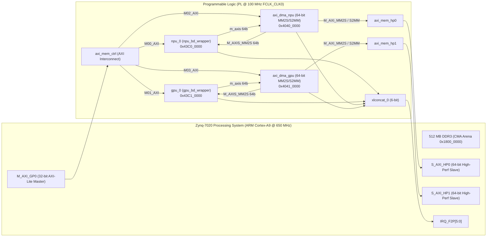

# Vivado 完整操作與硬體建置指南（PYNQ-Z2 `xc7z020clg400-1`）

本文件詳細說明如何使用 **Xilinx / AMD Vivado** 對本專案之 **CPU–NPU–Compute GPU 異質推論系統** 進行：
1. **Out-of-Context (OOC) 單獨加速器合成與資源/時序分析**（[`hw/vivado/synth_check.tcl`](../hw/vivado/synth_check.tcl)）
2. **一鍵建立 Zynq-7020 全系統 Block Design 與產生 Bitstream**（[`hw/vivado/create_bd.tcl`](../hw/vivado/create_bd.tcl)）
3. **Vivado GUI 圖形介面逐步手動操作教學（Step-by-Step）**
4. **軟硬體協同設計（Co-Design）硬體參數調整方法**
5. **匯出 PYNQ Overlay（`.bit` + `.hwh`）並部署至 PYNQ-Z2 板端**

---

## 1. 環境需求與檔案結構

### 1.1 硬體與軟體需求
- **目標板卡**：TUL PYNQ-Z2
- **FPGA / SoC 型號**：Zynq-7000 `xc7z020clg400-1`（Dual-core ARM Cortex-A9 @ 650 MHz + Artix-7 架構 PL：53,200 LUTs、106,400 FFs、140 BRAM36、220 DSP48E1）
- **建議 Vivado 版本**：Vivado 2020.2 ～ 2024.2（Windows 或 Linux 皆相容）
  - 若專案放置於 WSL2（`/home/a/Heterogeneous-CPU-NPU-Compute-GPU-System`），在 Windows 端啟動 Vivado 時可直接透過 `\\wsl.localhost\Ubuntu\home\a\Heterogeneous-CPU-NPU-Compute-GPU-System` 存取，或將儲存庫複製至 Windows 本機磁碟（例如 `C:\work\Heterogeneous-CPU-NPU-Compute-GPU-System`）以獲得最佳 I/O 編譯速度。

### 1.2 硬體相關檔案清單與編譯順序
Vivado 專案使用到的所有硬體原始碼與腳本如下（注意 SystemVerilog package 必須先於使用它的模組編譯）：

| 順序 | 檔案路徑 | 類型 | 角色說明 |
|---:|---|---|---|
| 1 | [`hw/rtl/common/fp32_alu.sv`](../hw/rtl/common/fp32_alu.sv) | SystemVerilog | `fp32_pkg` 與共用 IEEE-754 FP32 / INT32 / Q16.16 算術單元（含硬體 `recip`、`rsqrt`、`exp`、`silu`） |
| 2 | [`hw/rtl/npu/npu_pkg.sv`](../hw/rtl/npu/npu_pkg.sv) | SystemVerilog | NPU 暫存器位址與指令常數定義（`NPU_MAGIC_ID = 0x4E505531`） |
| 3 | [`hw/rtl/npu/npu_mac_array.sv`](../hw/rtl/npu/npu_mac_array.sv) | SystemVerilog | 參數化 `N_ROWS × N_LANES`（預設 8×8 = 64 MACs）有號數 INT8 乘加陣列 |
| 4 | [`hw/rtl/npu/npu_act_buf.sv`](../hw/rtl/npu/npu_act_buf.sv) | SystemVerilog | NPU 晶片上 Activation (`x_q`) 與群組縮放因子 (`x_s`) 緩衝區 |
| 5 | [`hw/rtl/npu/npu_top.sv`](../hw/rtl/npu/npu_top.sv) | SystemVerilog | NPU 頂層模組（AXI4-Lite Slave + 64-bit AXI4-Stream Slave/Master + 效能計數器） |
| 6 | [`hw/rtl/gpu/gpu_pkg.sv`](../hw/rtl/gpu/gpu_pkg.sv) | SystemVerilog | Compute GPU 32-bit ISA 編碼與暫存器定義（`GPU_MAGIC_ID = 0x47505531`） |
| 7 | [`hw/rtl/gpu/gpu_decoder.sv`](../hw/rtl/gpu/gpu_decoder.sv) | SystemVerilog | Compute GPU 指令解碼器（`[31:26] opcode | [25:22] rd | [21:18] rs1 | [17:14] rs2 | [13:0] imm14`） |
| 8 | [`hw/rtl/gpu/gpu_regfile.sv`](../hw/rtl/gpu/gpu_regfile.sv) | SystemVerilog | 16 × 4-lane × 32-bit 向量暫存器檔（支援 SIMT 尾端遮罩寫入） |
| 9 | [`hw/rtl/gpu/gpu_lane.sv`](../hw/rtl/gpu/gpu_lane.sv) | SystemVerilog | 單一 SIMD 運算通道（整合 `fp32_alu` 與 `vloop_idx + LANE_ID` 索引生成） |
| 10 | [`hw/rtl/gpu/gpu_scratchpad.sv`](../hw/rtl/gpu/gpu_scratchpad.sv) | SystemVerilog | 4096 words（16 KB）Scratchpad Memory（支援 4-lane 向量讀寫與 64-bit DMA 讀寫） |
| 11 | [`hw/rtl/gpu/gpu_lsu.sv`](../hw/rtl/gpu/gpu_lsu.sv) | SystemVerilog | Load/Store Unit（支援 `VLD`/`VST`、`SLD`/`SST`、以及 `RoPE` 用之 `VLD_ABS`/`VST_ABS` Gather/Scatter） |
| 12 | [`hw/rtl/gpu/gpu_controller.sv`](../hw/rtl/gpu/gpu_controller.sv) | SystemVerilog | 平行執行控制器（硬體 Strip-Mining `VRESET`/`VSTEP`、尾端 `lane_active` 遮罩、跨通道 `RADD`/`RMAX` 歸約） |
| 13 | [`hw/rtl/gpu/gpu_top.sv`](../hw/rtl/gpu/gpu_top.sv) | SystemVerilog | Compute GPU 頂層模組（AXI4-Lite Slave + 64-bit AXI4-Stream Slave/Master + 256-word IMEM） |
| 14 | [`hw/vivado/rtl_wrappers.v`](../hw/vivado/rtl_wrappers.v) | **Verilog-2001** | **Vivado Block Design 專用封裝**（`npu_bd_wrapper`、`gpu_bd_wrapper`），附帶 `X_INTERFACE_INFO` 讓 IP Integrator 自動識別 AXI 介面 |
| 15 | [`hw/vivado/pynq_z2.xdc`](../hw/vivado/pynq_z2.xdc) | XDC 約束檔 | PYNQ-Z2 腳位與時序約束檔 |

---

## 2. 流程一：Out-of-Context (OOC) 合成與資源/時序評估

在進行全系統 Block Design 佈線前，建議先執行 [`hw/vivado/synth_check.tcl`](../hw/vivado/synth_check.tcl)，單獨對 `npu_top` 與 `gpu_top` 進行 100 MHz Out-of-Context 合成，快速取得精確的硬體資源占用表與時序報告（約 2～3 分鐘）。

### 2.1 指令列執行方式（Batch Mode）
在開啟了 Vivado 環境的終端機（或 Anaconda / Vivado Command Prompt）中，切換至專案根目錄執行：

```bash
cd /path/to/Heterogeneous-CPU-NPU-Compute-GPU-System
vivado -mode batch -source hw/vivado/synth_check.tcl
```

### 2.2 Vivado GUI 執行方式
1. 開啟 **Vivado GUI**。
2. 於下方 **Tcl Console** 輸入：
   ```tcl
   cd C:/path/to/Heterogeneous-CPU-NPU-Compute-GPU-System
   source hw/vivado/synth_check.tcl
   ```

### 2.3 檢視合成報告與 Design Checkpoint (`.dcp`)
執行完成後，報告會自動輸出至 `hw/vivado/build/reports/`：
- **`npu_top_utilization.rpt`** / **`gpu_top_utilization.rpt`**：
  - 檢視 **Slice Logic**（`Slice LUTs`、`Slice Registers`）、**Memory**（`Block RAM Tile`）、**DSP**（`DSPs`）欄位，將數值填入論文之硬體資源分析表。
- **`npu_top_timing.rpt`** / **`gpu_top_timing.rpt`**：
  - 搜尋 `Design Timing Summary` 下方的 **WNS (Worst Negative Slack)**：
    - 若 `WNS >= 0.000 ns`，代表在 100 MHz（`10.000 ns` 週期）下時序完全收斂（Timing Met）。
    - 最大可運作頻率可由公式計算：$f_{\max} = \frac{1000}{10.000 - \text{WNS}}\text{ MHz}$。
- **在 GUI 檢視電路圖（Schematic）**：
  - 在 Vivado GUI 點選 **File → Checkpoint → Open...**，選擇 `hw/vivado/build/reports/npu_top_synth.dcp` 或 `gpu_top_synth.dcp`，即可按 `F4` 檢視合成後的 RTL / Technology Schematic 與 Critical Path。

---

## 3. 流程二：使用 `create_bd.tcl` 自動建立全系統 Block Design 與 Bitstream

本專案提供 [`hw/vivado/create_bd.tcl`](../hw/vivado/create_bd.tcl) 腳本，可自動完成專案建立、RTL 匯入、Zynq PS7 設定、NPU/GPU 模組實例化、雙通道 AXI DMA 連接、位址映射與頂層 Wrapper 產生。

### 3.1 系統硬體架構圖（Block Design `system`）



### 3.2 方法 A：僅建立 Vivado 專案與 Block Design（約 30 秒，之後可在 GUI 操作）
```bash
vivado -mode batch -source hw/vivado/create_bd.tcl
```
執行後會產生 `hw/vivado/proj/hetero_llm_pynq_z2.xpr`，可直接用 Vivado GUI 開啟：
```bash
vivado hw/vivado/proj/hetero_llm_pynq_z2.xpr
```

### 3.3 方法 B：一鍵完成建立專案 + Synthesis + Implementation + 匯出 `.bit` / `.hwh`
```bash
vivado -mode batch -source hw/vivado/create_bd.tcl -tclargs --bitstream
```
執行完成後，編譯好的 PYNQ Overlay 檔案會自動複製到：
- `hw/vivado/overlay/hetero_llm.bit`
- `hw/vivado/overlay/hetero_llm.hwh`

### 3.4 方法 C：在 Vivado GUI 中執行腳本並互動檢視
1. 開啟 **Vivado GUI**。
2. 在下方 **Tcl Console** 輸入：
   ```tcl
   cd C:/path/to/Heterogeneous-CPU-NPU-Compute-GPU-System
   source hw/vivado/create_bd.tcl
   ```
3. 腳本執行完畢後，GUI 中會自動呈現完整的 Block Design 圖形與設定好的 Address Map。
4. 點選左側 **Flow Navigator → PROGRAM AND DEBUG → Generate Bitstream**，按 **OK** 即可在 GUI 中監看 Synthesis 與 Implementation 進度。

---

## 4. 流程三：Vivado GUI 手動建立專案與 Block Design 逐步教學

若您希望不透過 `create_bd.tcl`，而在 Vivado GUI 中從零手動建立專案，請依循以下 8 個步驟：

### Step 1：建立新專案
1. 點選 **Create Project → Next**。
2. 輸入專案名稱 `hetero_llm_pynq_z2`，選擇存放路徑，勾選 **Create project subdirectory**。
3. 選擇 **RTL Project**（不勾選 Do not specify sources at this time）。
4. 在 **Default Part** 頁面：
   - 若已安裝 PYNQ-Z2 Board File，切換至 **Boards** 分頁選擇 `pynq-z2`。
   - 若未安裝 Board File，切換至 **Parts** 分頁，搜尋並選擇 **`xc7z020clg400-1`**。

### Step 2：加入 RTL 原始碼與 Verilog-2001 Wrapper
1. 在 **Add Sources** 頁面點選 **Add Files**，選取以下 14 個檔案：
   - `hw/rtl/common/fp32_alu.sv`
   - `hw/rtl/npu/npu_pkg.sv`、`npu_mac_array.sv`、`npu_act_buf.sv`、`npu_top.sv`
   - `hw/rtl/gpu/gpu_pkg.sv`、`gpu_decoder.sv`、`gpu_regfile.sv`、`gpu_lane.sv`、`gpu_scratchpad.sv`、`gpu_lsu.sv`、`gpu_controller.sv`、`gpu_top.sv`
   - **`hw/vivado/rtl_wrappers.v`**
2. **為什麼需要 `rtl_wrappers.v`？**
   - Vivado IP Integrator（Block Design）的 **Add Module...** 功能僅支援將 **Verilog-2001 (`.v`)** 或 VHDL 模組作為頂層 Block 加入畫布，不支援直接將 SystemVerilog (`.sv`) 模組拖入 Block Design。
   - [`hw/vivado/rtl_wrappers.v`](../hw/vivado/rtl_wrappers.v) 內含 `npu_bd_wrapper` 與 `gpu_bd_wrapper`，在內部實例化 `npu_top` 與 `gpu_top`，並透過 `(* X_INTERFACE_INFO = ... *)` 標註 `s_axi`、`s_axis`、`m_axis`、`clk`、`rst_n` 與 `irq` 介面。

### Step 3：加入 XDC 約束檔
1. 在 **Add Constraints** 頁面點選 **Add Files**，選擇 [`hw/vivado/pynq_z2.xdc`](../hw/vivado/pynq_z2.xdc)。
2. 點選 **Finish** 完成專案建立。

### Step 4：建立 Block Design 並設定 Zynq7 Processing System
1. 點選左側 **IP INTEGRATOR → Create Block Design**，Design name 輸入 `system`。
2. 點選畫布上的 **`+` (Add IP)**，搜尋並加入 **ZYNQ7 Processing System**。
3. 點選畫布上方綠色提示列 **Run Block Automation**（勾選 Apply Board Preset，將 `DDR` 與 `FIXED_IO` 設為 External）。
4. 雙擊 `processing_system7_0` 進入設定視窗，確認以下設定：
   - **PS-PL Configuration → AXI Non Secure Enablement → GP Master AXI Interface**：勾選 **`M AXI GP0 interface`**。
   - **PS-PL Configuration → HP Slave AXI Interface**：
     - 勾選 **`S AXI HP0 interface`**，Data Width 設為 **`64`** bits。
     - 勾選 **`S AXI HP1 interface`**，Data Width 設為 **`64`** bits。
   - **Clock Configuration → PL Fabric Clocks**：確認 **`FCLK_CLK0`** 為 **`100`** MHz。
   - **Interrupts → Fabric Interrupts**：勾選 **`Fabric Interrupts`** 並展開勾選 **`IRQ_F2P[15:0]`**。
   - （若未套用 PYNQ-Z2 Board Preset）於 **DDR Configuration** 選擇 Memory Part 為 **`MT41K256M16 RE-125`**。

### Step 5：加入 NPU、Compute GPU 與雙通道 AXI DMA
1. 在 Block Design 空白處按右鍵 → **Add Module...**：
   - 選擇 **`npu_bd_wrapper`**，按 OK（產生 `npu_bd_wrapper_0` 或重新命名為 `npu_0`）。
   - 再次按右鍵 → **Add Module...**，選擇 **`gpu_bd_wrapper`**，按 OK（重新命名為 `gpu_0`）。
2. 點選 **`+` (Add IP)**，搜尋 **AXI Direct Memory Access**，加入兩顆並分別命名為 `axi_dma_npu` 與 `axi_dma_gpu`。
3. 分別雙擊 `axi_dma_npu` 與 `axi_dma_gpu`，設定如下（兩顆設定相同）：
   - **取消勾選** `Enable Scatter Gather Engine`（使用 Direct Register Mode）。
   - **Width of Buffer Length Register** 改為 **`23`**（預設 14 bits 僅支援 16 KB，改為 23 bits 可支援單次最高 8 MB 權重傳輸）。
   - **Read Channel (MM2S)**：
     - `Memory Map Data Width` = **`64`**
     - `Stream Data Width` = **`64`**
     - `Max Burst Size` = **`64`**
   - **Write Channel (S2MM)**：
     - `Memory Map Data Width` = **`64`**
     - `Stream Data Width` = **`64`**（會自動從連線推導）
     - `Max Burst Size` = **`64`**

### Step 6：連接 AXI4-Stream、AXI4-Lite 與 S_AXI_HP0/HP1
1. **連接 AXI4-Stream 資料流**：
   - 將 `axi_dma_npu/M_AXIS_MM2S` 拉線至 `npu_0/s_axis`。
   - 將 `npu_0/m_axis` 拉線至 `axi_dma_npu/S_AXIS_S2MM`。
   - 將 `axi_dma_gpu/M_AXIS_MM2S` 拉線至 `gpu_0/s_axis`。
   - 將 `gpu_0/m_axis` 拉線至 `axi_dma_gpu/S_AXIS_S2MM`。
2. **執行 Connection Automation**：
   - 點選上方綠色提示列 **Run Connection Automation**，勾選所有項目：
     - 將 `npu_0/s_axi`、`gpu_0/s_axi`、`axi_dma_npu/S_AXI_LITE`、`axi_dma_gpu/S_AXI_LITE` 連接至 `M_AXI_GP0`（透過 `FCLK_CLK0` 100 MHz）。
     - 將 `axi_dma_npu` 的 `M_AXI_MM2S` 與 `M_AXI_S2MM` 連接至 **`S_AXI_HP0`**。
     - 將 `axi_dma_gpu` 的 `M_AXI_MM2S` 與 `M_AXI_S2MM` 連接至 **`S_AXI_HP1`**。
3. **連接中斷（選用，供中斷驅動擴充）**：
   - 加入 **Concat (`xlconcat`)** IP（設為 6 ports），將 `npu_0/irq`、`gpu_0/irq` 及兩顆 DMA 的 `mm2s_introut`/`s2mm_introut` 接至 `xlconcat_0`，並將 `dout` 接至 `processing_system7_0/IRQ_F2P`。

### Step 7：設定 Address Editor（必須與 C 驅動程式完全對齊）
切換至 **Address Editor** 分頁，確認或修改實體位址與 [`sw/driver/accel_hw.c`](../hw/driver/accel_hw.c) 一致：

| Master 介面 | Slave 實例 | 介面名稱 | Offset Address | Range | 對應 C 驅動巨集 |
|---|---|---|---|---|---|
| `processing_system7_0/Data` | `npu_0` | `s_axi` | **`0x43C0_0000`** | `64K` | `NPU_BASE_PHYS` |
| `processing_system7_0/Data` | `gpu_0` | `s_axi` | **`0x43C1_0000`** | `64K` | `GPU_BASE_PHYS` |
| `processing_system7_0/Data` | `axi_dma_npu` | `S_AXI_LITE` | **`0x4040_0000`** | `64K` | `DMA_NPU_BASE_PHYS` |
| `processing_system7_0/Data` | `axi_dma_gpu` | `S_AXI_LITE` | **`0x4041_0000`** | `64K` | `DMA_GPU_BASE_PHYS` |
| `axi_dma_npu/Data_MM2S` | `processing_system7_0` | `S_AXI_HP0` | **`0x0000_0000`** | `512M` | DDR3 實體位址空間 |
| `axi_dma_npu/Data_S2MM` | `processing_system7_0` | `S_AXI_HP0` | **`0x0000_0000`** | `512M` | DDR3 實體位址空間 |
| `axi_dma_gpu/Data_MM2S` | `processing_system7_0` | `S_AXI_HP1` | **`0x0000_0000`** | `512M` | DDR3 實體位址空間 |
| `axi_dma_gpu/Data_S2MM` | `processing_system7_0` | `S_AXI_HP1` | **`0x0000_0000`** | `512M` | DDR3 實體位址空間 |

### Step 8：驗證設計、產生 HDL Wrapper 與產生 Bitstream
1. 按 **`F6`**（或工具列勾號圖示 **Validate Design**），確認顯示 `Validation successful.`，然後按 `Ctrl+S` 儲存 Block Design。
2. 在 **Sources** 視窗的 `Design Sources` 下，對 **`system (system.bd)`** 按右鍵 → **Create HDL Wrapper...** → 選擇 **Let Vivado manage wrapper and auto-update** → 按 OK。
3. 對產生的 `system_wrapper` 按右鍵 → **Set as Top**。
4. 點選左側 **Flow Navigator → PROGRAM AND DEBUG → Generate Bitstream**。

---

## 5. 流程四：軟硬體協同設計（Co-Design）硬體參數調整指南

在進行 `method.md` 第 6.2 節的硬體資源與平行度探索實驗時，可在 Block Design 中直接雙擊 `npu_0` 或 `gpu_0`（或修改 [`hw/vivado/rtl_wrappers.v`](../hw/vivado/rtl_wrappers.v) 的預設 parameter）調整以下參數：

| 模組 | 參數名稱 | 預設值 | 可選配置範例 | 影響說明 |
|---|---|---:|---|---|
| `npu_bd_wrapper` | `N_ROWS` | `8` | `2`, `4`, `8` | NPU 同時計算的輸出列數（Tile 高度）；設為 `4` 時 DSP/LUT 減半，搭配 `run_hetero -R 4` |
| `npu_bd_wrapper` | `N_LANES` | `8` | `4`, `8` | 每列單週期內積通道數（64-bit AXI-Stream 每拍剛好提供 8 bytes INT8 權重） |
| `npu_bd_wrapper` | `MAX_DIM` | `1024` | `512`, `1024` | Activation Buffer 最大向量長度（`stories15M` 最大 `hidden_dim = 768`，設 `1024` 僅需 1 KB BRAM） |
| `gpu_bd_wrapper` | `N_LANES` | `4` | `2`, `4`, `8` | Compute GPU SIMD 平行運算通道數（每個 Lane 含 1 顆共用 `fp32_alu`） |
| `gpu_bd_wrapper` | `SPM_WORDS` | `4096` | `2048`, `4096` | Scratchpad Memory 容量（`4096` words = 16 KB = 4 個 1024-word 區段 `SPM_A..D`） |

---

## 6. 流程五：匯出 PYNQ Overlay（`.bit` + `.hwh`）與板端執行

### 6.1 找到 `.bit` 與 `.hwh` 檔案並重新命名
PYNQ 的 `pynq.Overlay("hetero_llm.bit")` 規定 **`.bit` 與 `.hwh` 必須放在同一個資料夾且主檔名完全相同**。
若您是透過 GUI 手動點擊 `Generate Bitstream`，請從 `hw/vivado/proj/` 目錄複製以下兩個檔案：

1. **Bitstream (`.bit`)**：
   ```text
   hw/vivado/proj/hetero_llm_pynq_z2.runs/impl_1/system_wrapper.bit
   ```
   複製為：`hw/vivado/overlay/hetero_llm.bit`

2. **Hardware Handoff (`.hwh`)**：
   - Vivado 2020.2 及更新版本：
     ```text
     hw/vivado/proj/hetero_llm_pynq_z2.gen/sources_1/bd/system/hw_handoff/system.hwh
     ```
   - Vivado 2020.1 及較舊版本：
     ```text
     hw/vivado/proj/hetero_llm_pynq_z2.srcs/sources_1/bd/system/hw_handoff/system.hwh
     ```
   複製為：`hw/vivado/overlay/hetero_llm.hwh`

### 6.2 部署至 PYNQ-Z2 板端並執行異質推論
當 PYNQ-Z2 板卡上線（預設 IP `192.168.2.99`）時：

```bash
# 1. 將交叉編譯好的 ARM 執行檔、模型與 Overlay 同步至 PYNQ-Z2
./tools/deploy_board.sh xilinx@192.168.2.99
scp hw/vivado/overlay/hetero_llm.{bit,hwh} sw/pynq/hetero_overlay.py xilinx@192.168.2.99:~/hetero-llm/

# 2. SSH 登入 PYNQ-Z2 並以 root 權限載入 Bitstream + 配置 CMA + 執行 Experiment E
ssh xilinx@192.168.2.99
cd ~/hetero-llm
sudo python3 hetero_overlay.py \
    --bitstream hetero_llm.bit \
    --binary run_hetero_prof \
    --model models/stories15M_q80.bin \
    --tokenizer models/tokenizer.bin \
    --exp E --backend hw --tile-rows 8 --steps 64 --hdmi
```

---

## 7. 常見問題與疑難排解（Troubleshooting）

1. **在 Block Design 按右鍵 `Add Module...` 看不到 `npu_top` 或 `gpu_top`？**
   - 這是因為 Vivado IP Integrator 不支援直接加入 `.sv` 模組。請選擇 [`hw/vivado/rtl_wrappers.v`](../hw/vivado/rtl_wrappers.v) 中的 **`npu_bd_wrapper`** 與 **`gpu_bd_wrapper`**。
2. **執行 `stories15M` 的 Classifier (`32000 × 288`) 時若在板端發生 DMA Timeout？**
   - 請確認 `axi_dma_npu` 與 `axi_dma_gpu` 的 **Width of Buffer Length Register (`c_sg_length_width`)** 已設為 **`23`**（而非預設的 `14`）。此外，[`run_hetero.c`](../sw/runtime/src/run_hetero.c) 已自動將矩陣切分為 `MAX_NPU_CHUNK_ROWS = 1024` 列之區塊（單次傳輸最大 `1024 × 768 = 768 KB`）。
3. **若在修改硬體參數後出現些微 Negative Slack（例如 `WNS = -0.2 ns`）？**
   - 可在 Vivado 左側 **Settings → Implementation → Strategy** 選擇 **`Performance_ExplorePostRoutePhysOpt`**，或在 `processing_system7_0` 的 **Clock Configuration** 將 `FCLK_CLK0` 由 `100 MHz` 調整為 `83.33 MHz` 或 `90 MHz`。
